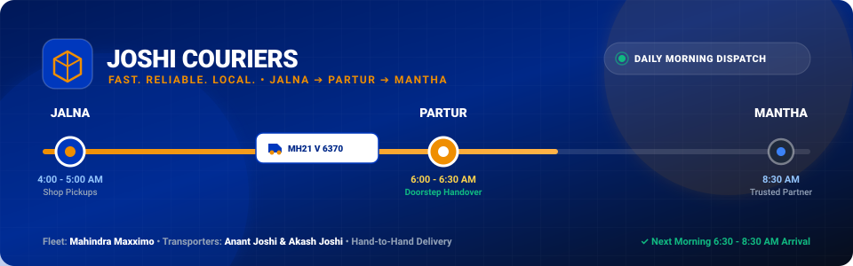
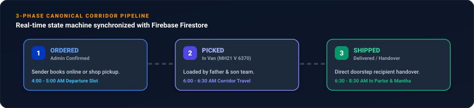

<div align="center">

  

  <br />

  <p align="center">
    <strong>Daily corridor parcel dispatch and live tracking portal for Jalna, Partur, and Mantha.</strong><br />
    Run directly by father &amp; son (Anant Joshi &amp; Akash Joshi) in dedicated vehicle <strong>Mahindra Maxximo (MH21 V 6370)</strong>.
  </p>

  <p align="center">
    <a href="#-quick-features"></a>
    <a href="#-daily-fleet--specs"></a>
    <a href="#-live-tracking-pipeline"></a>
  </p>

  <p align="center">
    
    
    
    
    
    
    
  </p>

</div>

---

## 🧭 Overview

**Joshi Couriers** is a specialized B2B and merchant logistics service connecting the industrial and textile hubs of **Jalna** to retail shops and medical distributors in **Partur** and **Mantha**. Unlike corporate hub-and-spoke couriers that route local parcels through distant Aurangabad or Pune sorting hubs, Joshi Couriers provides **zero-sorting, point-to-point morning corridor transport**.

Packages picked up from Jalna merchants in the late afternoon are securely stowed in **Mahindra Maxximo (MH21 V 6370)**, dispatched at 4:00 AM, and delivered hand-to-hand to shopkeepers in Partur between **6:30 AM and 8:30 AM** before markets open.

<br />

<div align="center">
  
</div>

<br />

---

## ⚡ Interactive Repository Demos & Features

<details open>
<summary><strong>🚚 1. Daily Corridor Route Timeline (Click to expand/collapse)</strong></summary>

<br />

```text
========================================================================================
                      DAILY NH-752I MORNING CORRIDOR SCHEDULE
========================================================================================

  [04:00 - 05:00 AM] JALNA DEPARTURE
         │           • Consignments loaded from Subhash Road, Cloth Market & MIDC
         │           • Secure stowage in Mahindra Maxximo MH21 V 6370
         ▼
  [05:00 - 06:00 AM] NH-752I HIGHWAY CORRIDOR (68 KM)
         │           • Direct point-to-point transit (Zero hub rerouting)
         │           • Weatherproof tarp + roof carrier tie-downs
         ▼
  [06:00 - 06:30 AM] PARTUR DISTRIBUTION ARRIVAL
         │           • Vehicle arrives at Partur distribution hub
         │           • Consignments sorted by bazaar delivery routes
         ▼
  [06:30 - 08:30 AM] HAND-TO-HAND SHOP DELIVERIES
         │           • Doorstep handover to merchants before shutters open
         │           • Cash-on-Delivery (COD) reconciliation
         ▼
  [08:30 - 10:00 AM] MANTHA EXTENSION RUN
                     • Connecting handover via trusted partner network
```

</details>

<details>
<summary><strong>📦 2. Real-Time Tracking &amp; Firestore Synchronization</strong></summary>

<br />

Every shipment booked on the platform follows an unambiguous 3-phase progression:

| Phase | Status ID | Description | Corridor Activity |
|:---|:---|:---|:---|
| **Phase 1** | `ordered` | Order request confirmed by admin | Jalna evening pickup scheduled |
| **Phase 2** | `picked` | Loaded into transport vehicle | Transporter has parcel inside MH21 V 6370 |
| **Phase 3** | `shipped` | Hand-to-hand delivery completed | Delivered to receiver in Partur or Mantha |

> **Sample Tracking IDs to test in the portal:**
> - `JC-84920` (Textile bolts to Partur Cloth Center)
> - `JC-10294` (Automotive gaskets to Mantha Auto Works)
> - `JC-39182` (Agri seeds to Jalna Seed Mart)

</details>

<details>
<summary><strong>📱 3. WhatsApp Dispatch &amp; Driver Run Sheet Engine</strong></summary>

<br />

The admin console provides 1-click formatted manifest generation designed specifically for daily driver operations:

```markdown
*JOSHI COURIERS - DAILY CORRIDOR DISPATCH SHEET*
*Fleet Vehicle:* Mahindra Maxximo (MH21 V 6370)
*Transporter Team:* Anant Joshi & Akash Joshi (+91 94040 40606)
*Dispatch Date:* Today
*Corridor:* Jalna (4:00-5:00 AM) ➔ Partur (6:00-6:30 AM) ➔ Mantha
*Delivery Window:* 6:30 - 8:30 AM Doorstep Delivery
===========================================

1. [JC-84920] Jalna ➔ Partur (PICKED)
   *To:* Rajesh Kothari (+91 94222 11223)
   *Drop Address:* Shop 4, Station Road, Partur
   *Item:* Cotton Sarees [1-5 kg]
   *Fare:* ₹75 [COLLECT CASH ON DELIVERY]

2. [JC-39182] Jalna ➔ Mantha (PICKED)
   *To:* Balaji Agro Agency (+91 98221 44556)
   *Drop Address:* Main Market Road, Mantha
   *Item:* Hybrid Cotton Seeds [5-10 kg]
   *Fare:* ₹95 [PAID ONLINE/DIRECT]

===========================================
*TOTAL CONSIGNMENTS:* 2
*TOTAL CASH TO COLLECT:* ₹75
```

</details>

<details>
<summary><strong>💰 4. Transparent Merchant Pricing Model</strong></summary>

<br />

| Weight Tier | Typical Cargo Items | Jalna to Partur | Jalna to Mantha | Delivery Window |
|:---|:---|:---:|:---:|:---:|
| **Upto 1 kg (Docs/Packets)** | Legal docs, sample swatches, medicines | **₹50** | **₹65** | Next Morning 6:30-8:30 AM |
| **1 kg to 5 kg (Standard)** | Small cloth parcels, electronics, auto spares | **₹75** | **₹90** | Next Morning 6:30-8:30 AM |
| **5 kg to 10 kg (Medium)** | Cotton bolts, hardware kits, bulk seeds | **₹95** | **₹115** | Next Morning 6:30-8:30 AM |
| **10 kg to 20 kg (Heavy)** | Machine parts, wholesale goods, bulk textiles | **₹130** | **₹150** | Next Morning 6:30-8:30 AM |

</details>

---

## 🛠️ Tech Stack & Architecture

This application is built with modern, production-grade web technologies:

- **Frontend Core**: [React 19](https://react.dev/) + [TypeScript 5.8](https://www.typescriptlang.org/)
- **Build System**: [Vite 6](https://vitejs.dev/) with hot module replacement and lightning-fast compilation
- **Styling**: [Tailwind CSS v4](https://tailwindcss.com/) with native OKLCH theme engine and zero runtime CSS overhead
- **Animations**: [GSAP 3.15](https://greensock.com/gsap/) with `useGSAP` hook context and physics motion curves
- **Database & Authentication**: [Firebase Firestore](https://firebase.google.com/docs/firestore) Enterprise Edition with fine-grained security rules (`firestore.rules`)
- **Icons**: [Lucide React](https://lucide.dev/) consistent vector iconography
- **Motion Polish**: [Motion](https://motion.dev/) declarative transitions

---

## 🚀 Quick Start Guide

Clone the repository and install dependencies to run the app locally:

```bash
# 1. Clone the repository
git clone https://github.com/joshi-couriers/joshi-couriers.git

# 2. Enter project directory
cd joshi-couriers

# 3. Install npm packages
npm install

# 4. Start local development server
npm run dev
```

The application will be accessible at: `http://localhost:3000`

### Build & Verification Commands

```bash
# Type check and lint codebase
npm run lint

# Production build
npm run build

# Preview production build locally
npm run preview
```

---

## 📁 Repository Structure

```text
├── .github/
│   ├── assets/
│   │   ├── hero-banner.svg         # Animated SVG brand banner
│   │   └── corridor-pipeline.svg   # 3-phase state machine SVG diagram
│   ├── workflows/
│   │   └── ci.yml                  # Automated build and typecheck CI
│   ├── ISSUE_TEMPLATE/
│   │   ├── bug_report.yml          # Interactive GitHub bug form
│   │   └── feature_request.yml     # Interactive feature request form
│   └── PULL_REQUEST_TEMPLATE.md    # Structured pull request guidelines
├── src/
│   ├── assets/                     # Real vehicle photography & logistics assets
│   ├── components/
│   │   ├── Header.tsx              # Sticky navigation with auth & portal controls
│   │   ├── Hero.tsx                # GSAP-driven vehicle proposition
│   │   ├── AdminDashboardModal.tsx # Fleet dispatch, bulk approval, WhatsApp engine
│   │   ├── CustomerParcelsModal.tsx# Client shipments history & monthly reports
│   │   ├── BookingModal.tsx        # Doorstep pickup booking modal
│   │   ├── RouteTimelineCard.tsx   # Morning corridor visual timeline
│   │   └── Footer.tsx              # Local contact & differentiator strip
│   ├── context/
│   │   ├── AuthParcelContext.tsx   # Firestore state, multi-role auth & tracking logic
│   │   ├── ThemeContext.tsx        # Light/Dark mode state with system detection
│   │   └── ToastContext.tsx        # Toast notifications
│   ├── data/
│   │   └── locations.ts            # Route coordinates & delivery milestones
│   └── types.ts                    # Strict TypeScript data shapes & interfaces
├── firebase-applet-config.json     # Provisioned Firebase configuration
├── firebase-blueprint.json         # Intermediate schema definition
├── firestore.rules                 # Hardened ABAC security rules
├── package.json
└── README.md
```

---

## 🔒 Security & Role-Based Access Control

The repository adheres strictly to Attribute-Based Access Control (ABAC):

1. **Admins (`admin`)**: Authorized administrators (`joshiakash1712@gmail.com`, `joshiakash1209@gmail.com`) can approve orders, update live corridor status, mark parcels picked/shipped, toggle cash-on-delivery collection, and access fleet analytics.
2. **Team / Transporters (`team`)**: Can view driver manifests and update phase transitions directly in vehicle MH21 V 6370.
3. **Merchants & Customers (`customer`)**: Can register bookings, view personal shipment history, generate monthly delivery reports, and track consignments.
4. **Public**: Can query individual tracking IDs without requiring account creation.

---

## 🤝 Contributing

We welcome community feedback, feature proposals, and code contributions.

1. Fork the Project
2. Create your Feature Branch (`git checkout -b feature/AmazingCorridorFeature`)
3. Commit your Changes (`git commit -m 'Add AmazingCorridorFeature'`)
4. Push to the Branch (`git push origin feature/AmazingCorridorFeature`)
5. Open a Pull Request

---

## 📄 License

Distributed under the **MIT License**. See `LICENSE` for more information.

<div align="center">
  <br />
  <p><strong>Joshi Couriers</strong> • Run by Anant Joshi &amp; Akash Joshi</p>
  <p>Old Jalna • Station Road • Phone: <a href="tel:+919404040606">+91 94040 40606</a></p>
  <p><em>Jalna ➔ Partur ➔ Mantha Morning Corridor Service</em></p>
</div>
